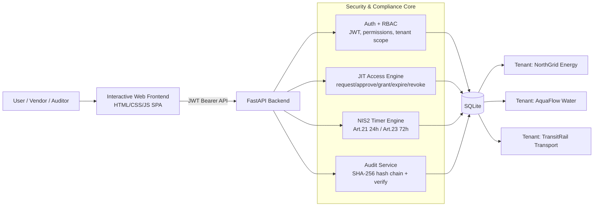

# BeeInControl — Multi-Tenant OT Fleet & NIS2 Access Control Simulator

BeeInControl is a recruiter-ready security engineering simulator that models real-world industrial access-control challenges: **multi-tenant OT fleet isolation**, **Just-In-Time (JIT) privileged vendor elevation**, **EU NIS2 Article 21/23 incident reporting timers (24h/72h)**, and a **SHA-256 hash-chained audit ledger** for tamper-evident traceability.

Built with **FastAPI + SQLite** on the backend and a lightweight interactive web frontend, the project demonstrates secure-by-design backend patterns, compliance-oriented workflows, and automated verification.

## Key Capabilities

- **Tenant Isolation (3 Industrial Tenants)**: Pre-seeded Energy, Water, and Transport tenants with strict tenant-scoped data access and cross-tenant `403` enforcement.
- **RBAC & Least Privilege**: Role/permission model for platform and tenant personas (admin, engineer, viewer, security officer, vendor), enforced server-side on API routes.
- **JIT Privileged Vendor Elevation**: Request → approve/reject → time-bound grant → revoke/expire workflow; vendor OT actions are authorized only through active, non-expired grants.
- **EU NIS2 Art. 21/23 Timers**: Incident lifecycle tracks **24-hour early warning** and **72-hour authority notification** deadlines, with server-computed timer state and overdue detection.
- **SHA-256 Hash-Chained Audit Ledger**: Append-only audit events linked by `previous_hash`/`hash` chain; verification endpoint detects tampering/mismatch.
- **Interactive Frontend**: Tenant/role-aware UI for fleet status, JIT controls, NIS2 incident simulation/timers, and audit log verification.

## Architecture

Detailed design: [`ARCHITECTURE.md`](./ARCHITECTURE.md)



## Security Audit Summary

Full report: [`SECURITY_AUDIT.md`](./SECURITY_AUDIT.md)

The security audit performed static analysis across backend, frontend, and tests, with concrete `file:line` findings and remediation guidance.

| Area | Audit Outcome |
|---|---|
| Tenant isolation & RBAC | **Strong positive controls**: tenant scoping and permission checks enforced server-side; cross-tenant access denied (`403`) in tested paths. |
| JIT vendor access | **Strong positive controls**: server-side time-window enforcement, active-grant checks, duplicate/expired grant handling. |
| NIS2 24h/72h timers | **Strong positive controls**: deadlines computed server-side; timer state/overdue derived by backend. |
| Hash-chained audit ledger | **Strong positive controls**: SHA-256 chain with sequence/previous-hash linkage and verification; tamper detection covered by tests. |
| Auth/secrets & hardening | Audit identified findings (incl. JWT secret handling and seed endpoint exposure) with prioritized fixes; F1/F2 security fixes were applied and reverified by QA. Residual hardening items remain documented (rate limiting, CORS tightening, etc.). |

> For severity-ranked findings, evidence, and recommended remediations, see `SECURITY_AUDIT.md`.

## Test Verification

Automated QA verification (pytest):

```text
python -m pytest tests/ -q
59 passed, 0 failed
```

Coverage includes tenant isolation/RBAC, JIT grant lifecycle/expiry, NIS2 Art. 21/23 deadline logic, and audit hash-chain tamper detection (including post-fix F1/F2 regression checks).

## Local Quickstart

### Prerequisites
- Python 3.11+ recommended
- `pip`

### 1) Install dependencies
```bash
pip install -r backend/requirements.txt
```

### 2) Run the simulator
```bash
python backend/run.py
```

The API starts on `http://127.0.0.1:8000` (FastAPI docs: `http://127.0.0.1:8000/docs`, API base: `http://127.0.0.1:8000/api/v1`).  
On first startup, the SQLite database is initialized/seeded for the simulator.

> If you prefer running from the backend directory: `cd backend && python run.py`.

## Project Structure

```text
.
├── ARCHITECTURE.md          # System design, data model, API, security/test strategy
├── SECURITY_AUDIT.md        # Severity-ranked audit findings and positive controls
├── WORKFLOW_STATE.json      # Agent workflow state/handoff tracking
├── backend/                 # FastAPI + SQLite API, auth/RBAC/JIT/NIS2/audit logic
│   ├── app/
│   ├── requirements.txt
│   └── run.py
├── frontend/                # Interactive web UI (tenant/RBAC/JIT/NIS2/audit views)
└── tests/                   # Pytest suite (RBAC, JIT, NIS2 timers, audit chain, regressions)
```

## Why This Project Matters (Recruiter Snapshot)

This simulator demonstrates practical skills relevant to **security engineering, OT/critical-infrastructure software, and compliance-aware backend development**:

- Designing **tenant-isolated** systems with enforceable authorization boundaries
- Implementing **privileged access workflows** (JIT elevation, expiry, revocation)
- Translating regulatory requirements (**NIS2 24h/72h**) into testable backend logic
- Building **tamper-evident audit trails** using cryptographic hash chaining
- Pairing implementation with **security audit artifacts** and **automated regression testing**
